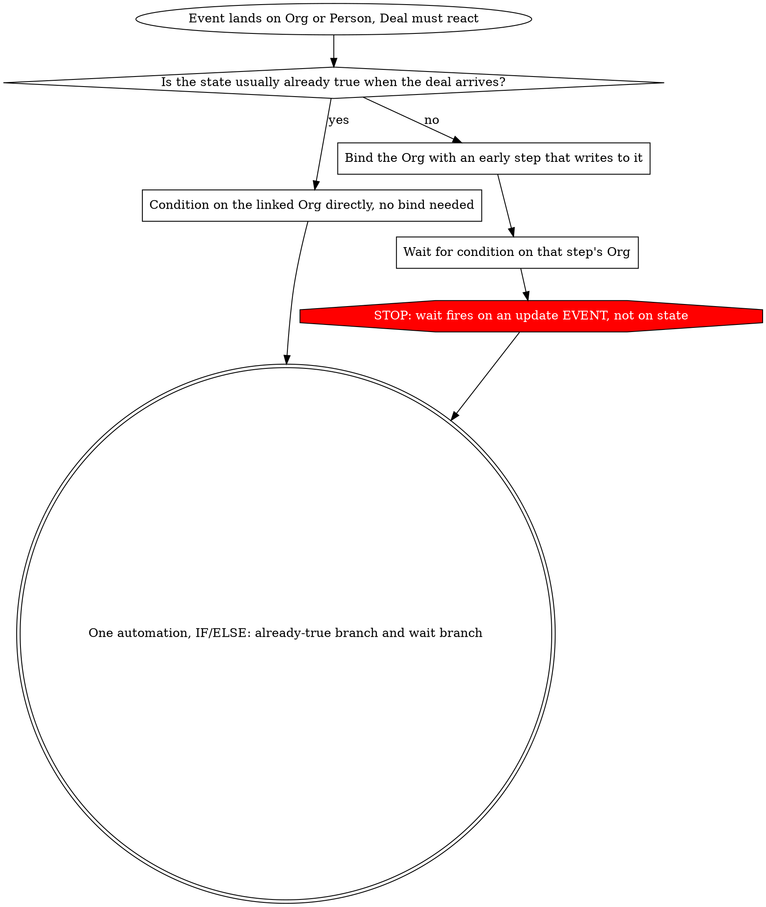

# Pipedrive Automations

## Overview

This skill is where a native Pipedrive automation is **scoped, planned and validated** — the design rules,
the capability limits, and the silent condition traps. **Reading, mirroring and diffing automations over
the API belongs to `pipedrive-config-sync`** (`node pipedrive-sync.mjs automations --write`, which writes
one JSON per rule into `<mirror>/automations/`); use that to produce the mirror, then use this skill to
judge it. The two together are the workflow: config-sync records **fact**, this skill supplies the
**intent and the design judgement** to act on it.

Two findings carry most of the design:

> **Automations traverse many-to-one, never one-to-many.**
>
> **You can read an automation. You cannot yet write one.** Build in the UI, mirror by API (via
> config-sync), diff in git.

Almost everything below is a consequence of one of those, or a trap in how Pipedrive evaluates a condition.

Behaviour marked *proven* was established by live test in a Pipedrive account in August 2026, and is undocumented by Pipedrive. Carry the date when you cite it.

## When to use

- Designing, building, editing, or reviewing any native Pipedrive automation
- Deciding whether a rule belongs in an automation, a filter, or a script
- An automation fires but writes nothing, never fires, or its wait step expires
- A gate never opens, a flag never sets, a stage never advances
- An integration or form updates Persons or Organizations and a Deal needs to react
- Taking over an automation set nobody documented, or validating one before go live
- **Confirming a rule you just built matches the plan it was designed from** — mirror it with config-sync and diff against the spec
- Judging what a rule is *for*, whether it is well-formed, and whether it has ever fired

**Run `pipedrive-config-sync` first, every time.** Never map an automation to a field key you have not verified against live. Mirroring an existing set — and mirroring a rule you have just built so you can validate it against its plan — is config-sync's job (`node pipedrive-sync.mjs automations --write`); for REST scripting rather than native rules, use `pipedrive-api`.

**Reading an existing set beats reasoning about it.** Before designing anything into an account that already has automations, mirror them with config-sync: one file per rule, committed. That answers questions no amount of care can answer from the UI list — which rules watch a field, what a trigger fires on, whether a rule has run. This skill is what you use to *judge* the result: is the rule well-formed, is it aimed at the right object, does its recipient resolve to the right human.

## The rule that predicts the rest

**An automation may write to a single-valued reference. It may not write to a collection.**

| Trigger | Write target | Cardinality | Legal |
|---|---|---|---|
| Deal | itself | same record | Yes |
| Deal | its Organization | many-to-one | Yes |
| Deal | its Person | many-to-one | Yes |
| Person | its Organization | many-to-one | Yes |
| Organization | its Deals | one-to-many | **No** |
| Person | its Deals | one-to-many | **No** |
| Organization | its Persons | one-to-many | **No** |

A Deal has exactly one Organization, so Pipedrive offers it as a target. An Organization has many Deals, so "update the deal" has no defined target and the action is simply absent from the UI.

**Consequence:** if the event lands on an Organization or a Person, nothing can *push* it to a Deal. Invert the design so the Deal pulls.

## When the event lands on the wrong object

**Bind, then wait.** A Deal-triggered automation can pause until its linked Organization changes and carry the result back. Three properties, all proven, none documented:

1. **The Organization must be bound first.** It becomes selectable as a wait target or condition source only *after* an earlier step interacts with it. An `Update organization fields` step on `Deal organization` is enough; later steps then address it by that step's number.
2. **The wait re-fetches.** Pipedrive logs `Data fetching successful` once the condition passes, and later steps read post-change values. One wait can serve many subsequent Organization reads.
3. **The wait fires on an update event, not on current state.** A wait on a field that is *already* populated expires instead of passing.

Property 3 is the one that bites. **Every bind-and-wait gate needs a companion path for the already-satisfied case**, and in a mature account that path carries most of the volume. Build both as one automation with an `IF/ELSE`: test the already-satisfied state first, wait only on the else branch.

**Give the bind step useful work.** Its write is incidental to the binding, so make it something harmless and wanted, such as defaulting Yes/No flags to `No`. Never bind with an owner write, which silently reassigns records.

**Reading needs no bind.** Binding is a requirement of the `wait` step only. A condition on the linked Organization, or a filter that reads it, works with no bind step at all.

**An expired wait is the correct failure**, visible in the history log, and it leaves the record parked where a rotten-stage threshold will surface it. Check the log during the first week of any wait-based rule.

## Prefer a filter to an inline condition

A deal filter can carry a condition on the linked Organization or Person, and a filter can be used as an automation condition (`Filter matches`).

**Move every non-trivial condition into a named filter.** A filter is **rebuildable** from a declarative file and editable over the API; an automation is only readable. So the filter is the half you can version and recreate, and what stays in the automation is a thin action wrapper. Twenty automations sharing one filter also means one edit instead of twenty.

Check all four on every filter used as an automation condition:

- **Visibility.** A filter created owner-only silently narrows an automation that runs for everyone. Set it to the entire company.
- **Numeric field ids.** Filter conditions reference a numeric `field_id`, never the 40-character hash key. Grepping a filter for a hash finds nothing and hides a broken filter.
- **Two flat groups, no nesting.** A condition tree is one `and` group and one `or` group, evaluated as `(and) AND (or)`. Nesting returns a 400.
- **Cross-object filters may be UI work**, if the tooling resolves field names against deal fields only. Record the resolved condition JSON so it can be rebuilt by hand.

## Before you assert a limit

**Three platform limits asserted during one build proved false within days**, each after a redesign had already been written around it: that no integration event could reach a Deal, that automations could not branch, and that conditions could not cross objects. Automations do have an `IF/ELSE CONDITION` step with `CONDITION MET` and `CONDITION NOT MET` paths, proven nested at least five levels deep. Deal filters do carry `{"object": "organization", ...}` conditions.

**Test the limit in the direction you intend to use it, before designing around it.** A capability recorded as "read a linked Organization's field and write it to a Deal" is two capabilities, and only the read was real.

**Write "not found in the UI", never "impossible".**

| Rationalization | Reality |
|---|---|
| "The docs don't mention it, so it can't be done" | Bind-then-wait is undocumented and works. Docs are a floor, not a ceiling. |
| "It wasn't in the dropdown, so the platform can't do it" | It may not be there *yet*. The bind step is exactly this case. Say where you looked and when. |
| "This capability was confirmed last week" | Confirm the direction. Read and write are separate capabilities. |
| "Designing around it is safer than testing it" | A redesign costs hours. Opening the automation editor costs ten minutes. |
| "One test proved it, no need to date it" | Platform behaviour changes. Every capability claim carries a date. |
| "The plan limit says we cannot" | Ask the account for the real cap and usage (config-sync reads it), not the published table. Published tables and on-screen banners have both been seen to be wrong. |
| "There is no API for this" | Said of automations for months, on the evidence of a guessed path returning 404. config-sync proved the real endpoint exists; a 404 on a guess is evidence about the guess, not the platform. |

**Red flags. Stop and go test in the UI:**

- About to write "cannot", "impossible", or "not supported" about Pipedrive
- About to add a script, a middleware layer, or a manual step because a native path "doesn't exist"
- Citing a capability someone else confirmed, in a different direction from the one needed
- Designing a workaround before opening the automation editor

## The registry records intent, the mirror records fact

The mirror (produced by config-sync) tells you what a rule **does**. It cannot tell you what it was
**for**, which rule supersedes it, or why a decision was reversed. Keep both, and do not let either stand
in for the other.

1. Run config-sync's drift check. Verify every field key against live.
2. **Write the registry entry before building it in the UI**, not after. That entry is the **plan** the
   build is validated against.
3. Build it. Record the build date and the acting user.
4. **Validate the build against the plan** — this is what the mirror is for. Run
   `pipedrive-sync.mjs automations --write` (config-sync), then read the mirrored definition of the rule
   you just built and check it against step 2, item by item: the trigger event and its watched fields,
   every condition and its operator, each action and the object it writes to, and the resolved
   recipient / stage / webhook ids. **The build is done only when the mirror matches the plan.** A
   divergence — a `contains` where the plan said `is`, a wait on a field that is already set, a write
   aimed at the wrong object, a `person_id_email` recipient that resolves to the wrong human — is a
   defect caught before go-live rather than after. Commit the diff as the review artifact.
5. Verify it **fired**, not just that it exists — config-sync mirrors the execution history for a rule's uuid
   (see reading-automations.md there). `completed` means the steps ran, not that an email arrived. After any
   duplication run, sweep deal titles for `(copy)`.
6. Keep reversals in the registry, dated, with what they touched. A registry showing only current state
   cannot explain records written last month.

**A name and a description are not a specification.** An inherited set read only from the list view is
undocumented, and the list view is worse than it looks: it defaults to "Owned by me", so on an account
where one person built everything it shows every other user an empty account. Mirror it with config-sync
and read the definitions, not the list.

**Drift is detectable.** Re-run config-sync's `automations` drift check and diff it; it exits non-zero when
the mirror is stale, so "the account changed under us" is a failed command rather than a discovery.

**The one thing the mirror cannot judge is whether a rule is any good.** The definition tells you the
recipient is `person_id_email`. Only reading the mail template's salutation tells you that address is the
wrong human. That judgement is this skill's job: resolve every id a step points at, then decide.

## Quick reference

| Symptom | Rule |
|---|---|
| Yes/No field never matches `is No` | No boolean type exists. An unset enum is empty, not No. Write `is not Yes`. |
| `contains CTO` matched `Postdoctoral Researcher` | `is` for abbreviations and single words. `contains` only for multi-word phrases. |
| Need "two of four flags are Yes" | Automations cannot count related records and filters cannot express N-of-M. Precompute one gate field. |
| Formula field blank on every record | One empty input blanks the whole result. Zero-initialise every component. |
| Rules trigger each other in a chain | Watch named fields, never "any field updated". |
| Two rules race on record creation | Scope each with a stage or pipeline check so it cannot fire outside its lane. |
| A due date lands a day early or late | Timezone is inherited from whoever built the rule. Pin it explicitly. |
| The automations list is empty on an account you know has rules | The UI list defaults to "Owned by me". Mirror with config-sync, which has no such default. |
| "Was this rule ever actually used?" | Check the execution history config-sync mirrors. Definition means wired, history means fired. |
| "Is it safe to rename or delete this field?" | Grep config-sync's automation mirror for its 40-character key. The automation UI has no usage view. |
| Need the real automation cap for this plan | Ask the account via config-sync, not the published plan table (they have been seen to disagree). |

Field-level evaluation traps in detail: [condition-traps.md](condition-traps.md).
What is and is not expressible at all, with limits: [capability-map.md](capability-map.md).
Reading, auditing and mirroring automations over the API is the **`pipedrive-config-sync`** skill (its `automations` subcommand and `reading-automations.md`).

## Common mistakes

- **Building before writing it down.** The mirror records what you built; only the registry records what you meant. Write the entry first.
- **Reporting a rule as broken without checking whether it has ever run.** The execution history is one request and it separates a live defect from a dormant one.
- **Trusting a step's field label over the field key.** `dynamicRegistry` labels are a snapshot from when the automation was saved. On an account with duplicate field names, the label is exactly what cannot distinguish the twins.
- **Gating on a field nothing populates.** A gate depending on manual entry is a gate that never opens. Derive it from something an integration writes.
- **Splitting mutually exclusive rules into separate automations.** `IF/ELSE` collapses them, and fewer rules is the whole point when none of them are reviewable.
- **Counting rules as progress.** Twenty-three unreviewable rules in an environment with no data is a liability, not a build. Build what makes the pipeline run, defer anything whose threshold can only be set against data that does not exist yet.
- **Cascading off enrichment instead of off a stage move.** One rule carries the wait and ends with a stage change; every downstream rule triggers on that stage change. Wait steps are capped per automation, so one wait must serve the whole model.
